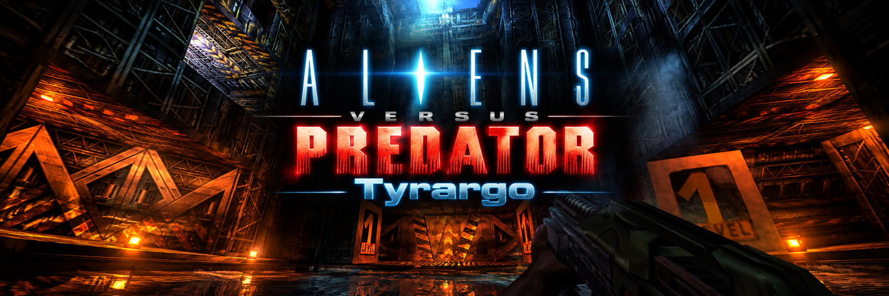
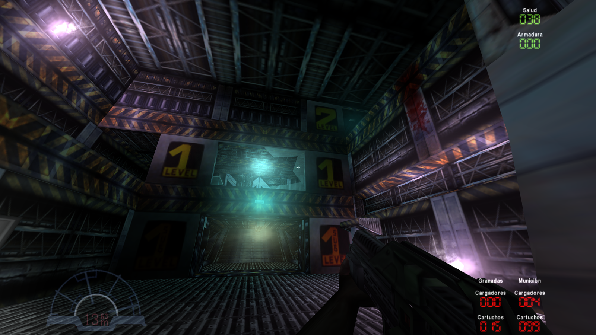
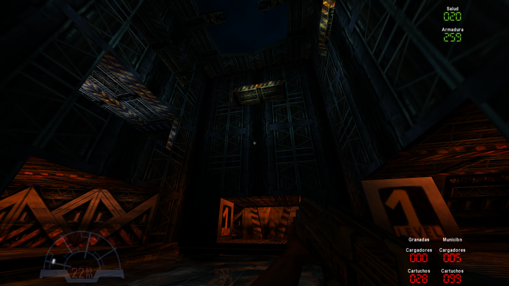
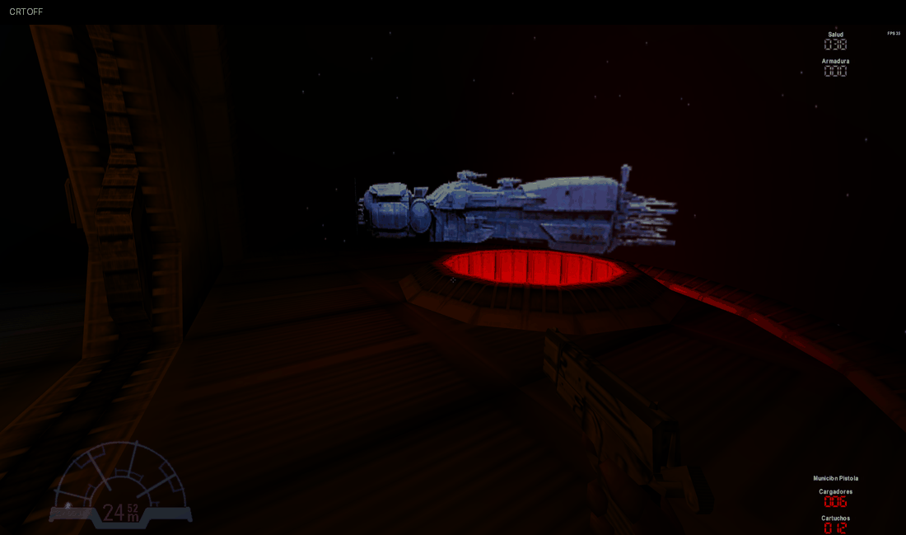

<h1 align="center">Aliens vs Predator Tyrargo</h1>

<a href="README.md">English</a> · <b>Español</b>

Tyrargo mejora el motor clásico de Aliens versus Predator mediante entrada precisa, una presentación audiovisual ampliada, nuevos sistemas singleplayer y comportamiento NPC coordinado. Deriva de [NakedAVP 1.2.3 de atsb](https://github.com/atsb/NakedAVP), sobre el código original de Rebellion y ports anteriores de la comunidad.

Es un proyecto independiente, no comercial, sin afiliación con Rebellion ni los titulares de la franquicia. Rebellion creó y posee el juego/código original; se conserva su [licencia no comercial y créditos obligatorios](LICENSE). Los datos originales del juego se suministran por separado.

**Las instrucciones están en [Cómo instalar y jugar](docs/es/install-and-play.md).** Desarrolladores: [compilar desde el código](docs/es/build.md).

Candidato actual: **v6.252 RC1**, Windows x64. **[Descargar binarios y notas de versión](https://github.com/Sol1vaN/AVP-Tyrargo/releases/tag/v6.252-rc1)**. Debes suministrar los datos de Gold CD o Classic Steam/GOG. La misma release incluye código, fuentes de dependencias y materiales para volver a enlazar.

## Showcase

 <a href="https://youtu.be/p9oYk3mTuwo">▶ Ver el showcase</a>

GitHub no permite incrustar un reproductor YouTube en el README. Esta vista previa abre el vídeo con un clic.

*CRT desactivado/activado en Tyrargo, usando el par suministrado. La cuantización de colores del GIF pertenece a la documentación, no al render del juego.* [Comparaciones estáticas y galería completa](docs/es/gallery.md).

## Objetivos

- Mejorar y pulir la experiencia de usuario (UX) en todos sus aspectos: mouse input, teclado, físicas, framepacing, UI, gameplay IA de los enemigos.
- Ampliar gameplay y eyecandy con increíbles novedades, pero siempre permitiendo al usuario volver al comportamiento vanilla original, para los más puristas.
- Mejorar la estabilidad/robustecimiento del engine reduciendo el trabajo caro del render, colisiones e IA sin eliminar efectos ni reducir la concurrencia/cantidad de elementos en pantalla.

## Mejoras destacadas

| Correcciones | QoL | Funciones | Total |
|---:|---:|---:|---:|
| 53 | 17 | 46 | 116 |

Son **cambios implementados consolidados**, contados una sola vez; no prometen ausencia de bugs. Experimentos repetidos se conservan en el [historial del desarrollo](docs/es/history.md), sin volver a contarlos como funciones nuevas.

- **[Mouse, teclado y binds](docs/es/features.md#input)** — Ángulos directos del mouse a la cámara · Restos subangulares yaw/pitch (9).
- **[Modos de pantalla y presentación](docs/es/features.md#display)** — Modos ventana, sin bordes y exclusivo · Cambios transaccionales de modo de vídeo (8).
- **[Proyección y precisión geométrica](docs/es/features.md#geometry)** — Transformación y clipping float · Precisión de secciones móviles jerárquicas (7).
- **[Render, iluminación y efectos](docs/es/features.md#render)** — Pasada luminosa/especular respetando alpha · Sincronización UV de capas luminosas (7).
- **[Simulación y render de agua](docs/es/features.md#water)** — Propagación y amortiguación de ondas por tiempo · Agua clásica y moderna seleccionable (6).
- **[CRT, ruido y ajustes de imagen](docs/es/features.md#postfx)** — Filtro CRT GLSL nativo · Controles de brillo, contraste y saturación (5).
- **[Menú principal, menú ingame y UX](docs/es/features.md#ui)** — Identidad Tyrargo y versión común · Starfield panorámico y fondos recuperados (11).
- **[Vídeos y capturas](docs/es/features.md#media)** — Reproducción nativa Smacker y Bink · Reloj de audio, RGB y finalización sincronizados (6).
- **[Audio, música y latencia](docs/es/features.md#audio)** — EFX ambiental y efectos NPC posicionales · Audio solapado de armas primarias/secundarias (6).
- **[Movimiento y armas del jugador](docs/es/features.md#player)** — Deslizamiento y contacto con superficies curvas · Apoyo de plataforma móvil y contacto al saltar (8).
- **[Movimiento de cámara, armas y HUD](docs/es/features.md#motion)** — Bobbing y sway procedural caminar/correr · Feedback suave agacharse, escaleras, salto y aterrizaje (5).
- **[Campaña, recursos y Molecular Acid](docs/es/features.md#campaign)** — Persistencia opcional entre episodios · Modo campaña de munición optimizada (9).
- **[Comportamiento y navegación de Alien NPC](docs/es/features.md#aliens)** — Tiempo fraccional de movimiento NPC · Recuperación en ductos, escotillas y bordes (5).
- **[Combate y patrulla de Predator NPC](docs/es/features.md#predators)** — Inventario NPC privado y elección de arma · Taunts Predator al matar (5).
- **[Escuadrón, inventario y tácticas Marine NPC](docs/es/features.md#marines)** — Órdenes usar follow/patrol con confirmación · Planner de exploración expansiva coordinada (14).
- **[Vida útil, rendimiento y diagnóstico del motor](docs/es/features.md#kernel)** — BVH de mallas inmutables para actores/partículas · Fallback dinámico y limpieza de caché (5).

[Catálogo completo por categoría](docs/es/features.md) · [Explicaciones técnicas, código, flujos y ejemplos](docs/es/technical.md) · [Evidencia de rendimiento](docs/es/performance.md).

## Diferencias y procedencia

| Área | Base NakedAVP 1.2.3 | Tyrargo |
|---|---|---|
| Entrada y precisión | Port SDL3/OpenGL comunitario del motor original | Ángulos fraccionales del mouse y precisión de proyección/viewmodel |
| Presentación | Presentación clásica | FOV/interfaz por especie, vistas previas, CRT, agua moderna y encuadres panorámicos |
| Singleplayer | Campaña y dificultades nativas | Persistencia, opciones de ammo y niveles Molecular Acid |
| Apoyo NPC | Comportamiento nativo por especie | Follow/patrol, suministros compartidos, inventarios, torretas y recuperación de navegación |
| Rendimiento | Envío y consultas de colisión legacy | Buffers ordenados, filtro espacial y trabajo de apoyo compartido acotado |

AvPx es una mejora comunitaria independiente usada como referencia histórica. Tyrargo **no deriva de AvPx**. La tabla compara la base NakedAVP inspeccionada con nuestros cambios; no clasifica completitud ni rendimiento frente a otros ports. [Créditos y referencias](CREDITS.md).

## Compilación y desarrollo

La plataforma de validación mantenida es **Windows x64, GCC UCRT64 de MSYS2, SDL3, OpenAL y OpenGL de escritorio**. Decodificadores Smacker/Bink y utilidades de captura están incluidos. Otras plataformas y la ruta GLES heredada necesitan validación independiente.

Consultar [compilación, diagnóstico y versiones](docs/es/build.md) y [flujo manual local/GitHub](docs/es/workflow.md). Los cambios permanecen locales hasta hacer push explícito. Ningún workflow publica builds ni releases automáticamente.

## Gracias

- **Rebellion**, creadores originales y titulares del código; autores de ports anteriores y comunidad AvP.
- **[atsb / NakedAVP](https://github.com/atsb/NakedAVP)**, base directa.
- **[XProger / OpenLara](https://github.com/XProger/OpenLara)** y **[FluffyQuack / OpenLara](https://github.com/FluffyQuack/OpenLara)**, referencias del agua y trabajo comunitario.
- **[HelelSingh / CRT-Guest-ReShade](https://github.com/HelelSingh/CRT-Guest-ReShade)** y **[Mattias Gustavsson / newpixie](https://github.com/mattiasgustavsson/newpixie)**, trabajo y referencias del shader CRT.
- Autores de decodificadores, SDL, OpenAL, stb y compiladores. [Créditos completos](CREDITS.md) y [licencias de terceros](THIRD_PARTY_NOTICES.md).

## TODO

- Partículas suaves
- Archivos locales de música
- Restaurar y validar multiplayer/coop
- Selector de mapas y cargador de mods
- Selector de idioma ingame
- Demos, binds y reproducción de showcase en menú

[Hoja de ruta categorizada y estados](docs/es/roadmap.md). Propuestas y conceptos no se cuentan como implementaciones.
